<p align="center">
  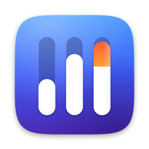
</p>

<h1 align="center">Sound Control</h1>

<p align="center">A lightweight menu bar mixer for macOS in the style of Control Center: per-app volume, output boost and device switching.</p>

<p align="center">
  <a href="#requirements"></a>
  <a href="docs/DEVELOPMENT.md"></a>
  <a href="LICENSE"></a>
  <a href="#ai-assisted-development"></a>
</p>

> [!NOTE]
> This app was developed with AI assistance. See [AI-assisted development](#ai-assisted-development).

## In action

### Per-app volume and devices

<p align="center">
  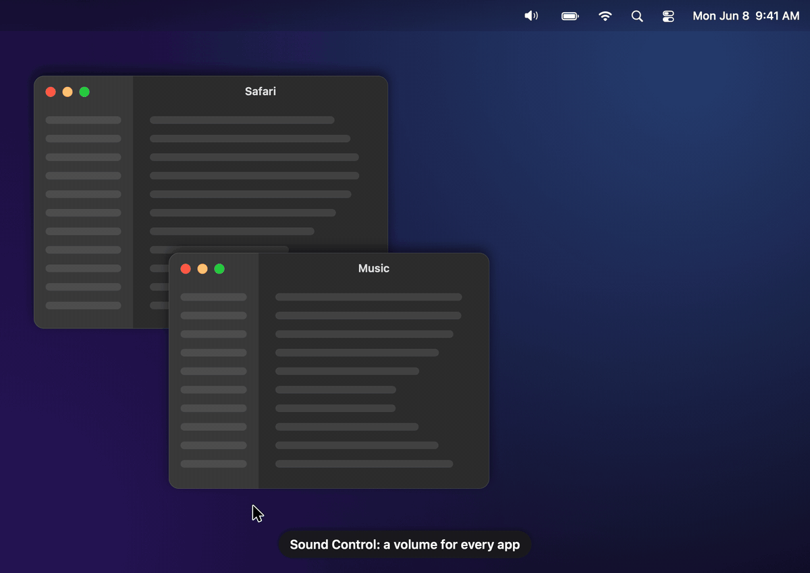
</p>

Drag an app's slider to turn it down, or beyond 100 % to boost it, while every other app keeps its level. The output device is switched from the same menu.

<sub>The animations are rendered by the app itself from invented demo data; nothing on your Mac is recorded.</sub>

## Features

- **Per-app volume** from 0 to 200 % with a limiter against clipping when boosting; double-click a slider to reset to 100 %.
- **Output and input devices**: switch with one click, hide devices you never use, set the microphone volume and mute it.
- **Output boost** up to 200 %: the device regulates itself up to 100 %, above that Sound Control amplifies (shown in orange).
- **AirPlay rooms** appear by their room name once macOS has connected them.
- **Advanced mode**: per-app sound profiles, balance, mono and a custom output device, plus a fixed sample rate per device.
- **Update notice** (optional, off by default): once a day the app looks up the latest release on GitHub and shows
  "Version X available" in the menu, with **Download** (opens the release page) and **Skip**.
- **Remembers** your settings per app across restarts; quiet apps collapse under "More Apps", nothing jumps while you drag.

## Screenshots

<p align="center">
  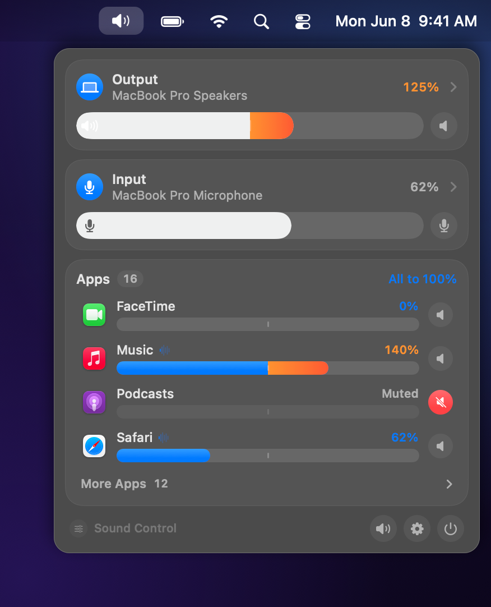
  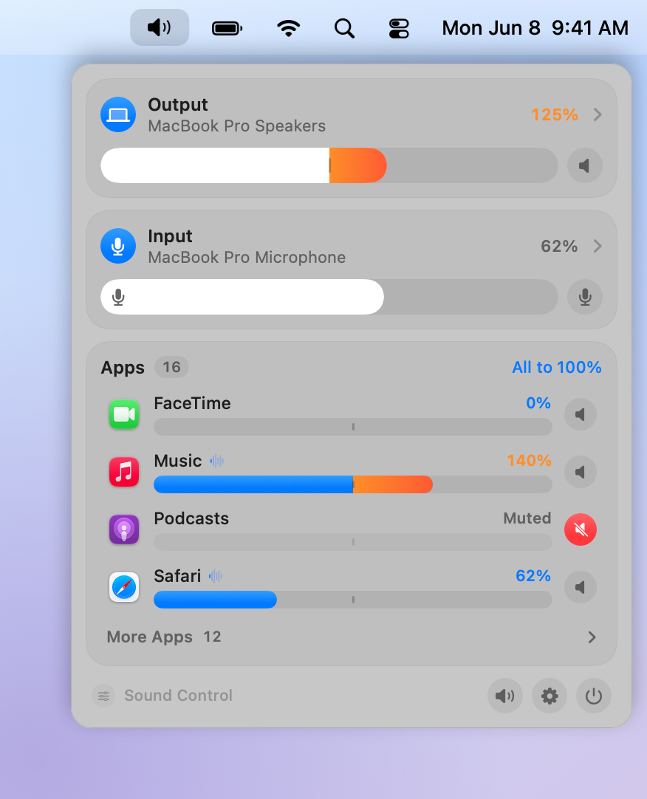
</p>

<table>
<tr>
<td align="center">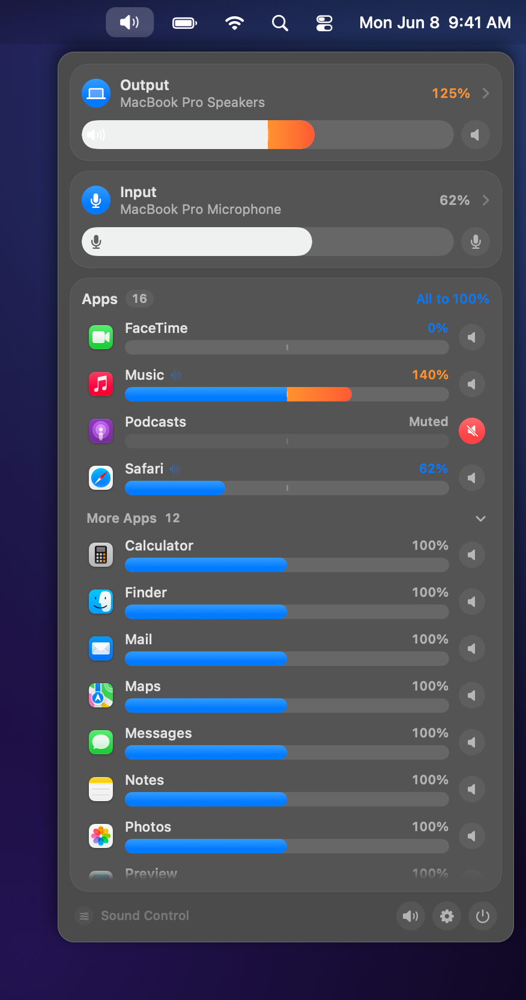<br>All apps, including the quiet ones under "More Apps"</td>
<td align="center">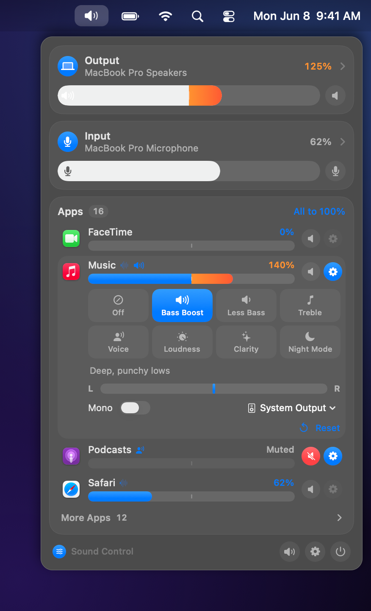<br>Advanced mode: sound profiles, balance, mono and output per app</td>
</tr>
<tr>
<td align="center">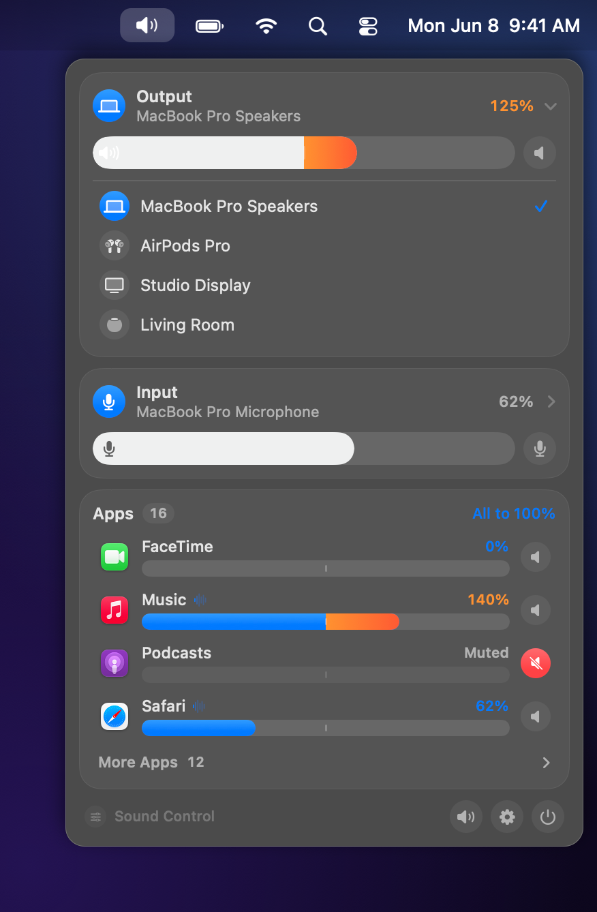<br>Choosing the output device</td>
<td align="center">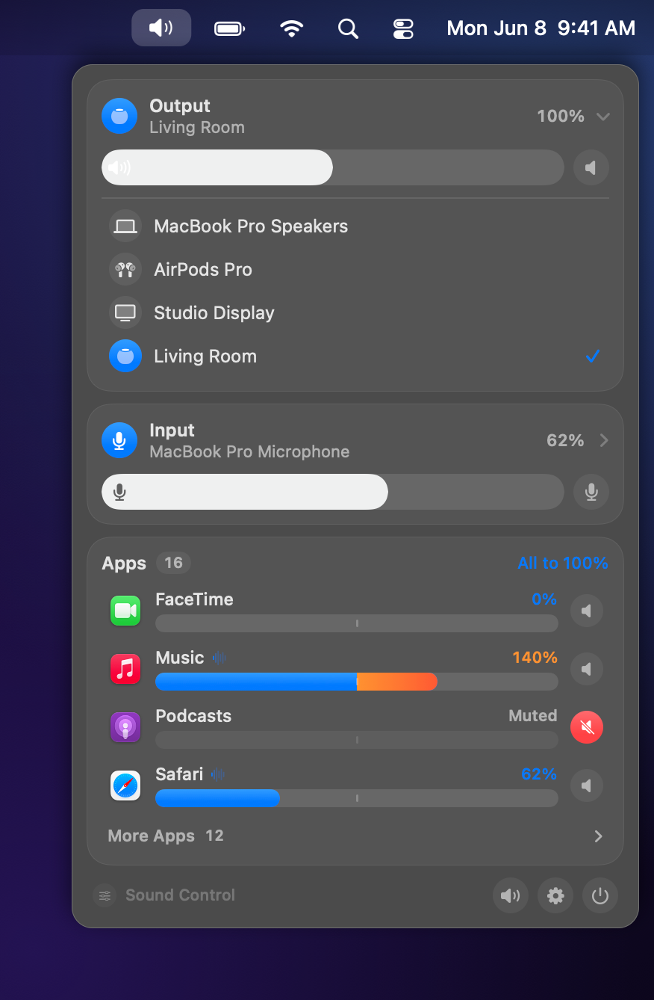<br>AirPlay rooms shown by name</td>
</tr>
<tr>
<td align="center"><br>Hiding devices you never use</td>
<td align="center">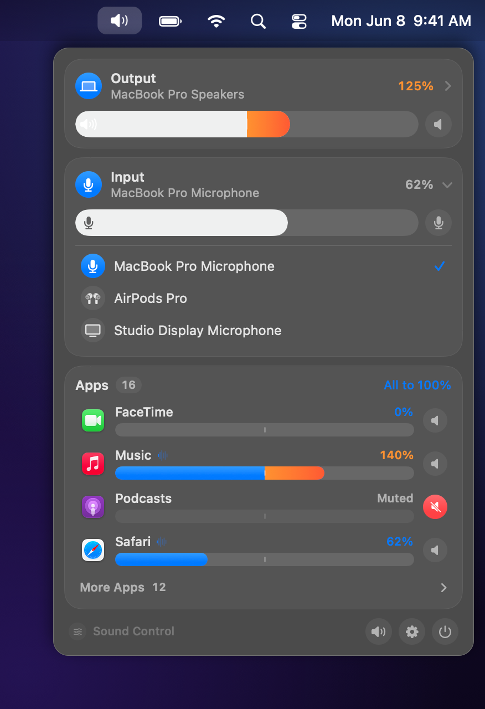<br>Choosing the microphone</td>
</tr>
<tr>
<td align="center">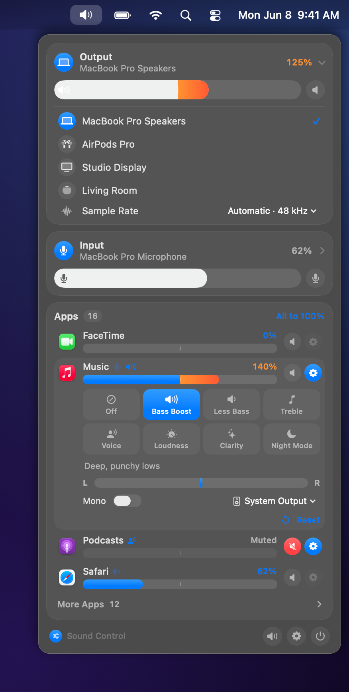<br>Fixed sample rate per device (advanced mode)</td>
<td align="center">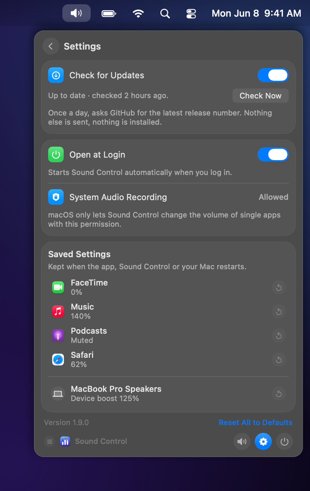<br>Settings and saved per-app values</td>
</tr>
<tr>
<td align="center">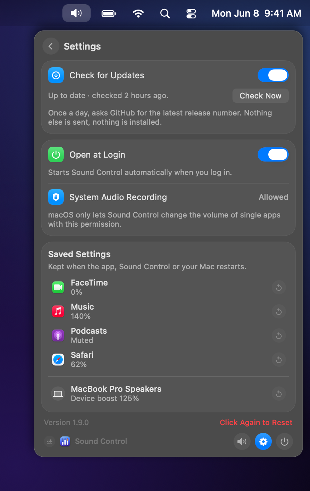<br>Two-step reset</td>
<td align="center">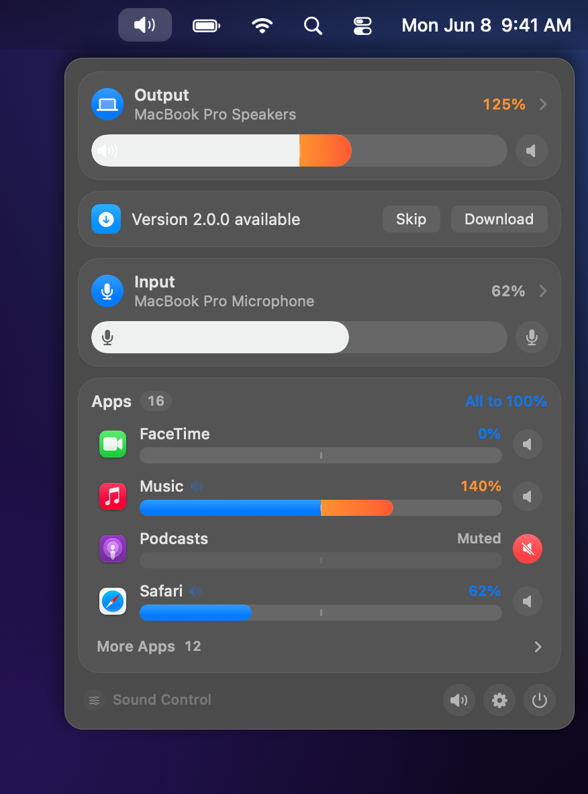<br>Update notice in the menu</td>
</tr>
</table>

## Requirements

- macOS 26 or later on Apple silicon

## Installation

1. Download `SoundControl-<version>.zip` from the [latest release](../../releases/latest) and unzip it.
2. Move **SoundControl.app** to `/Applications`.
3. Open it. The app is free and ad-hoc signed, not notarized by Apple, so macOS blocks the first launch:
   open **System Settings → Privacy & Security**, scroll down and click **Open Anyway**.
   Alternatively, in Terminal: `xattr -dr com.apple.quarantine /Applications/SoundControl.app`
4. The first time you change an app's volume, allow **System Audio Recording** when asked
   (see [Permissions and privacy](#permissions-and-privacy)).

The app starts at login by default; switch this off under Settings (gear icon) → **Open at Login**.
To uninstall, quit it from the menu and move it to the Trash.

## Usage

- Click the menu bar item. The top section sets the output device and volume (up to 200 %), then the microphone.
- Drag an app's slider to change only that app; double-click to reset it to 100 %.
- Open the output or input list to switch or hide devices; hidden ones sit under "Hidden".
- The small button at the bottom left turns on **advanced mode** (sound profiles, balance, mono, output per app, sample rate).
- The gear icon opens settings: stored values, a two-step reset, **Check for Updates** and **Open at Login**.
- **Updates**: with **Check for Updates** on, a new version appears in the menu. **Download** opens the release page; replace the
  app in `/Applications` with the new one. Your settings and permissions stay.

## Build from source

```sh
brew install xcodegen
git clone https://github.com/ape97/SoundControl.git && cd SoundControl
./scripts/check.sh    # build + snapshots + self-test -> RESULT: GREEN
./scripts/deploy.sh   # check, install to /Applications, restart
```

No Apple developer account is needed. Project layout, scripts, signing, screenshots and releases are described in
[docs/DEVELOPMENT.md](docs/DEVELOPMENT.md).

## Permissions and privacy

- **System Audio Recording** (System Settings → Privacy & Security → Screen & System Audio Recording, audio only): required
  for per-app volume, boost and sound profiles. To change an app's volume, Sound Control taps that app's audio output with
  Core Audio process taps, processes it in memory and plays it back. Only apps whose sound you actually change are tapped;
  all other apps run untouched. The audio is never recorded to disk or sent anywhere. Without the permission the device
  volume, device switching and microphone controls still work.
- **Local Network**: used only to find AirPlay speakers on your network via Bonjour (`_airplay._tcp`), so they can be
  shown by room name. macOS asks the first time you expand the output list. If you decline, the name stays "AirPlay".
- **Microphone**: declared because the app shows and adjusts the volume and mute state of your input device. It does not
  record or listen to your microphone.

Everything stays on your Mac, no telemetry. The only stored data are your settings per app in the app's user defaults.
There are two kinds of network access. The local Bonjour search for AirPlay speakers stays on your network. The optional
update check (off by default) sends one request per day to `api.github.com` for the latest release number of this
repository; nothing about you or your Mac is sent.

## AI-assisted development

Sound Control was built with the help of an AI coding assistant: code, comments, documentation and the screenshot
pipeline were written in collaboration with AI. Every change is built and checked with `scripts/check.sh`
(warning-free build, snapshots, self-test) and the app is in daily use on the maintainer's Mac.
Issues and pull requests are welcome.

## License

MIT, see [LICENSE](LICENSE).
